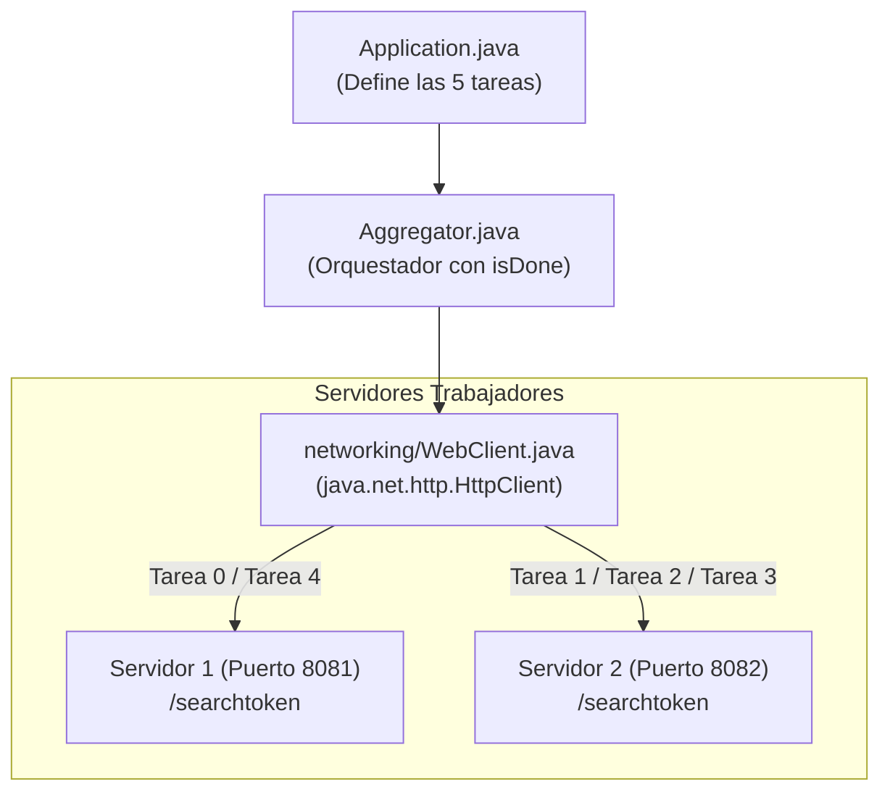

# MEMORY: Práctica Clase 19 - Cliente HTTP Asíncrono en Java

Este documento preserva la memoria técnica, decisiones de diseño, contexto del entorno, fundamentación teórica y resultados experimentales de la práctica correspondiente al **Cliente HTTP Asíncrono en Java** de la materia **Sistemas Distribuidos**.

---

## 📌 Contexto General del Proyecto

- **Materia:** Sistemas Distribuidos
- **Profesor:** Dr. Ukranio Contreras Coronilla (ESCOM - IPN)
- **Tema:** Cliente HTTP Asíncrono, `CompletableFuture`, Connection Pooling, Monitoreo con `isDone()` y Balanceo Dinámico de Tareas.
- **Ruta de trabajo:** [`d:\SistemasDistribuidos\19`](file:///d:/SistemasDistribuidos/19)
- **Repositorio:** `KYaelDLRG/sistemas_distribuidos` (rama `main`)
- **Video de referencia oficial:** [Cliente HTTP en Java (YouTube: zc0QeO93ito)](https://www.youtube.com/watch?v=zc0QeO93ito)

---

## ⚙️ Entorno de Desarrollo y Configuración del Sistema

| Parámetro | Detalle en el Sistema |
| :--- | :--- |
| **Sistema Operativo** | Windows 11 (PowerShell / CMD / Git Bash) |
| **Compilador (`javac`)** | Amazon Corretto JDK 21.0.4 (`C:\Program Files\Amazon Corretto\jdk21.0.4_7\bin\javac.exe`) |
| **Runtime (`java`) para Cliente Asíncrono** | Amazon Corretto JDK 21.0.4 (Requerido por la API moderna `java.net.http.HttpClient`) |
| **Runtime en PATH predeterminado** | Java SE 8 (`1.8.0_441`) |
| **Empaquetado** | Archivo JAR (`Application.jar`) generado con `jar -cfe` |

> [!IMPORTANT]
> **Compatibilidad de `java.net.http.HttpClient`:**
> La API `java.net.http` forma parte del estándar de Java desde Java 11. Dado que el sistema tiene instalado **Amazon Corretto JDK 21**, la compilación y ejecución del cliente y servidores se realiza utilizando dicho JDK (disponible en `C:\Program Files\Amazon Corretto\jdk21.0.4_7\bin\`), automatizado a través de `Makefile` y scripts `.bat`.

---

## 🧠 Respuestas Teóricas a las Consultas con la IA

### 1. ¿Qué diferencia existe entre un cliente HTTP en Java síncrono y un asíncrono?
- **Cliente HTTP Síncrono (Bloqueante):**
  - El hilo que emite la solicitud HTTP queda completamente suspendido (bloqueado en I/O de red) esperando a que el servidor remoto termine de procesar y devuelva la respuesta completa.
  - No puede atender otras tareas en ese intervalo. Si se deben procesar $N$ solicitudes de forma secuencial, el tiempo total es la suma acumulada de los tiempos individuales ($\sum T_i$).
  - Consume recursos de hilos del sistema operativo mientras permanece inactivo esperando datos de la red.
- **Cliente HTTP Asíncrono (No Bloqueante):**
  - El hilo emisor despacha la petición y recupera el control de inmediato mediante una promesa o futuro (`CompletableFuture<T>`).
  - El transporte de red y la espera de I/O se delegan al motor reactivo subyacente (`java.net.http.HttpClient`), permitiendo reutilizar conexiones TCP existentes (**Connection Pooling** con HTTP/1.1).
  - Permite enviar peticiones concurrentes a múltiples servidores trabajadores en paralelo, monitorear cuál finaliza primero y balancear la carga de trabajo dinámicamente sin bloquear el hilo principal.

### 2. ¿Cuál es la funcionalidad del método `isDone()` perteneciente a la clase `CompletableFuture`?
- **Definición y Comportamiento:**
  - El método `isDone()` pertenece a la interfaz `Future` y la clase `CompletableFuture<T>`.
  - Retorna un valor booleano:
    - **`true`:** Si la tarea asíncrona ya terminó (ya sea con éxito produciendo un resultado, de forma excepcional con error, o cancelada).
    - **`false`:** Si la tarea sigue en ejecución o pendiente de respuesta por parte del servidor.
- **Utilidad Práctica:**
  - Es una operación de consulta de estado **no bloqueante**. A diferencia de `get()` o `join()` (que bloquean el hilo llamador hasta obtener el resultado), `isDone()` permite realizar sondeo (*polling*) para saber si un servidor trabajador ha quedado libre y puede recibir inmediatamente la siguiente tarea disponible.

---

## 🏛️ Arquitectura del Sistema Distribuido



### Componentes:
1. **[`networking/WebClient.java`](file:///d:/SistemasDistribuidos/19/networking/WebClient.java):**
   - Paquete `networking`.
   - Encapsula `java.net.http.HttpClient` configurado con `HttpClient.Version.HTTP_1_1`.
   - Método `sendTask(String url, byte[] payload)`: Crea un `HttpRequest` con método `POST` y despacha asíncronamente con `client.sendAsync()`, devolviendo un `CompletableFuture<String>`.
2. **[`Aggregator.java`](file:///d:/SistemasDistribuidos/19/Aggregator.java):**
   - Importa `networking.WebClient`.
   - Administra los `CompletableFuture<String>[] futures`.
   - Asigna inicialmente una tarea por servidor (8081 recibe Tarea 0, 8082 recibe Tarea 1).
   - En un ciclo `while(active)`, verifica con `futures[j].isDone()` qué servidor terminó.
   - En cuanto un servidor termina, recupera el resultado con `join()`, imprime el mensaje con sangría `"  El servidor ... completó la tarea ..."` y le asigna la siguiente tarea disponible de la cola.
3. **[`Application.java`](file:///d:/SistemasDistribuidos/19/Application.java):**
   - Configura las URLs de los trabajadores (`http://localhost:8081/searchtoken`, `http://localhost:8082/searchtoken`).
   - Define las 5 tareas:
     - Tarea 0: `1757600,IPN` (Carga pesada: $1,757,600$ tokens)
     - Tarea 1: `17576,SAL` (Carga ultraligera: $17,576 = 26^3$ tokens)
     - Tarea 2: `70000,MAS` (Carga ligera: $70,000$ tokens)
     - Tarea 3: `1757600,PEZ` (Carga pesada: $1,757,600$ tokens)
     - Tarea 4: `175700,SOL` (Carga media: $175,700$ tokens)
   - Imprime el inventario inicial y los resultados finales formateados.
4. **[`ServidorHttp.java`](file:///d:/SistemasDistribuidos/19/ServidorHttp.java):**
   - Servidor HTTP basado en `com.sun.net.httpserver.HttpServer` con ThreadPool de 8 hilos.
   - Endpoint `/searchtoken`: Lee `"<cantidad>,<TOKEN>"`, genera `<cantidad>` tokens aleatorios de 3 letras ('A'-'Z') y cuenta cuántas veces coincide exactamente con el token solicitado.

---

## 🔬 Resultados y Verificación Experimental

### Salida Exacta Obtenida en Consola:
```text
Las tareas a resolver son las siguientes:
Tarea 0 :1757600,IPN
Tarea 1 :17576,SAL
Tarea 2 :70000,MAS
Tarea 3 :1757600,PEZ
Tarea 4 :175700,SOL

Al servidor http://localhost:8081/searchtoken se le asigna la tarea: 1757600,IPN
Al servidor http://localhost:8082/searchtoken se le asigna la tarea: 17576,SAL
  El servidor http://localhost:8082/searchtoken completó la tarea 17576,SAL
Al servidor http://localhost:8082/searchtoken se le asigna la tarea: 70000,MAS
  El servidor http://localhost:8082/searchtoken completó la tarea 70000,MAS
Al servidor http://localhost:8082/searchtoken se le asigna la tarea: 1757600,PEZ
  El servidor http://localhost:8081/searchtoken completó la tarea 1757600,IPN
Al servidor http://localhost:8081/searchtoken se le asigna la tarea: 175700,SOL
  El servidor http://localhost:8081/searchtoken completó la tarea 175700,SOL
  El servidor http://localhost:8082/searchtoken completó la tarea 1757600,PEZ

Para la tarea 1757600,IPN El numero de apariciones es 100

Para la tarea 17576,SAL El numero de apariciones es 0

Para la tarea 70000,MAS El numero de apariciones es 3

Para la tarea 1757600,PEZ El numero de apariciones es 84

Para la tarea 175700,SOL El numero de apariciones es 11
```

---

## 🗂️ Índice de Archivos en `19/`

| Archivo | Tipo | Descripción |
| :--- | :---: | :--- |
| [`networking/WebClient.java`](file:///d:/SistemasDistribuidos/19/networking/WebClient.java) | Código Java | Cliente HTTP asíncrono en paquete `networking`. |
| [`Aggregator.java`](file:///d:/SistemasDistribuidos/19/Aggregator.java) | Código Java | Orquestador con balanceo dinámico de carga mediante `isDone()`. |
| [`Application.java`](file:///d:/SistemasDistribuidos/19/Application.java) | Código Java | Clase principal con las 5 tareas y formateo de resultados. |
| [`ServidorHttp.java`](file:///d:/SistemasDistribuidos/19/ServidorHttp.java) | Código Java | Servidor HTTP concurrente con endpoint `/searchtoken` y puerto parametrizable. |
| [`Application.jar`](file:///d:/SistemasDistribuidos/19/Application.jar) | Binario JAR | Paquete ejecutable generado con las clases compiladas del cliente. |
| [`Makefile`](file:///d:/SistemasDistribuidos/19/Makefile) | Automatización | Reglas para `make compile`, `make jar`, `make run`. |
| [`compilar.bat`](file:///d:/SistemasDistribuidos/19/compilar.bat) | Script Windows | Compila las clases y genera `Application.jar`. |
| [`ejecutar_servidor_8081.bat`](file:///d:/SistemasDistribuidos/19/ejecutar_servidor_8081.bat) | Script Windows | Lanza el servidor en el puerto 8081. |
| [`ejecutar_servidor_8082.bat`](file:///d:/SistemasDistribuidos/19/ejecutar_servidor_8082.bat) | Script Windows | Lanza el servidor en el puerto 8082. |
| [`ejecutar_cliente.bat`](file:///d:/SistemasDistribuidos/19/ejecutar_cliente.bat) | Script Windows | Ejecuta `Application.jar`. |
| [`ejecutar_todo_demo.bat`](file:///d:/SistemasDistribuidos/19/ejecutar_todo_demo.bat) | Script Windows | Automatiza la compilación, apertura de servidores y ejecución completa. |
| [`README.md`](file:///d:/SistemasDistribuidos/19/README.md) | Documentación | Guía completa de uso e instrucciones de ejecución. |
| [`reporte_teams.md`](file:///d:/SistemasDistribuidos/19/reporte_teams.md) | Entrega | Formato formal para entrega de práctica en Teams. |
| [`MEMORY.md`](file:///d:/SistemasDistribuidos/19/MEMORY.md) | Memoria Técnica | Este documento integral de registro y decisiones. |
