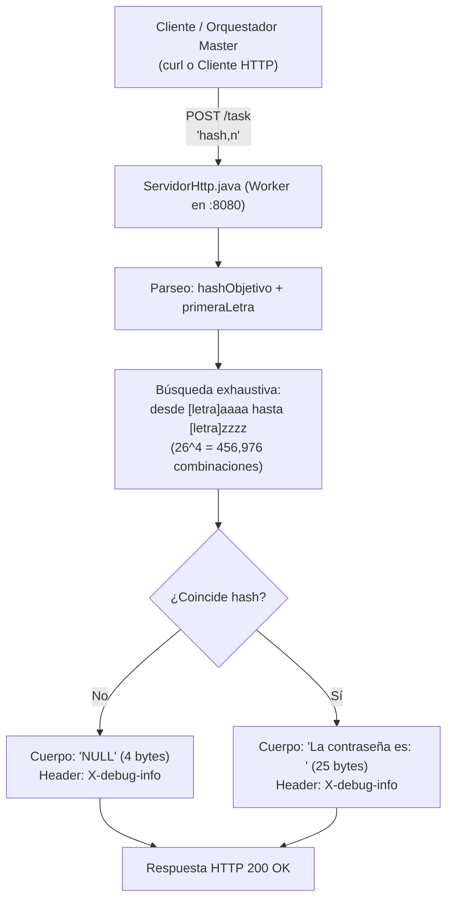

# MEMORY: Práctica Clase 21 - Criptografía Hash (SHA-256), Fuerza Bruta y Servidor de Cómputo Distribuido

Este documento preserva la memoria técnica, decisiones de diseño, fundamentación teórica, análisis criptográfico-matemático, resultados experimentales y guía paso a paso correspondiente a los ejercicios de la **Clase 21: Funciones Hash Criptográficas (SHA-256), Ataque por Fuerza Bruta y Procesamiento Distribuido** de la materia **Sistemas Distribuidos**.

---

## 📌 Contexto General del Proyecto

- **Materia:** Sistemas Distribuidos
- **Profesor:** Dr. Ukranio Contreras Coronilla (ESCOM - IPN)
- **Tema:** Funciones Hash Criptográficas (SHA-256), `MessageDigest`, Ataque por Fuerza Bruta (*Brute-Force Attack*), Espacio de Búsqueda Criptográfico, Métricas de Rendimiento (*Speedup* Móvil vs Laptop) y Descomposición Distribuida tipo MapReduce mediante Servidores Web HTTP.
- **Ruta de trabajo:** [`d:\SistemasDistribuidos\21`](file:///d:/SistemasDistribuidos/21)
- **Repositorio:** `KYaelDLRG/sistemas_distribuidos` (rama `main`)

---

## ⚙️ Entorno de Desarrollo y Configuración del Sistema

| Parámetro | Detalle en el Sistema |
| :--- | :--- |
| **Sistema Operativo** | Windows 11 (PowerShell / CMD / Git Bash) |
| **Compilador (`javac`)** | Amazon Corretto JDK 21.0.4 (`C:\Program Files\Amazon Corretto\jdk21.0.4_7\bin\javac.exe`) |
| **Runtime prioritario en PATH** | Java SE 8 (`1.8.0_441`) |
| **Runtime alternativo** | Amazon Corretto JDK 21 (`C:\Program Files\Amazon Corretto\jdk21.0.4_7\bin\java.exe`) |
| **Herramientas de Red** | `curl` (versión nativa 8.13.0 de Windows / curl de Git Bash) |

> [!IMPORTANT]
> **Compatibilidad de Compilación:**
> Para asegurar compatibilidad total con la versión de ejecución predeterminada del sistema (Java 8) y evitar el error `UnsupportedClassVersionError: class file version 65.0 recognizes up to 52.0`, todas las clases Java se compilan con el flag:
> ```powershell
> javac --release 8 <NombreClase>.java
> ```

---

## 🔬 Prueba Preliminar: `TestSHA.java`

### 1. Requisito
> *"Pruebe que no obtenemos el mismo hash para las cadenas 'hola', 'Hola' y 'HOLA'."*

### 2. Implementación ([`TestSHA.java`](file:///d:/SistemasDistribuidos/21/TestSHA.java))
Se utiliza la API estándar `java.security.MessageDigest` con el algoritmo `"SHA-256"`. Cada byte resultante (con signo) se formatea en representación hexadecimal sin signo de dos dígitos (`%02x`).

### 3. Resultados Experimentales Obtenidos
```text
=== Verificación de Funciones Hash (SHA-256) ===
Demostración: cadenas 'hola', 'Hola' y 'HOLA' no producen el mismo hash

Cadena: "hola"
SHA-256: b221d9dbb083a7f33428d7c2a3c3198ae925614d70210e28716ccaa7cd4ddb79

Cadena: "Hola"
SHA-256: e633f4fc79badea1dc5db970cf397c8248bac47cc3acf9915ba60b5d76b0e88f

Cadena: "HOLA"
SHA-256: 73c3de4175449987ef6047f6e0bea91c1036a8599b43113b3f990104ab294a47

¿Todos los hashes son completamente distintos?: true
Conclusión: SHA-256 es sensible a mayúsculas/minúsculas y presenta efecto avalancha.
```

### 4. Fundamentación Teórica
- **Efecto Avalancha (*Avalanche Effect*):** La alteración de tan solo un bit en la entrada (por ejemplo, entre la letra `'h'` ASCII 104 y la `'H'` ASCII 72) provoca que aproximadamente el 50% de los 256 bits de la salida cambien de forma determinista pero aparentemente aleatoria.
- **Unidireccionalidad:** A partir de cualquiera de los 3 hashes resultantes de 64 caracteres hexadecimales es computacionalmente inviable deducir la palabra original por métodos algebraicos directos.

---

## 💻 Ejercicio 1: Ataque por Fuerza Bruta de 5 Letras (`Ejercicio1.java`)

### 1. Requisito
> *"Modifique el programa anterior para encontrar en lugar de una contraseña de tres letras minúsculas, una de cinco letras minúsculas. Inicialice con una palabra conocida de cinco letras que inicie con la letra 'z' para maximizar el cómputo y tome la captura de pantalla como comprobante de este ejercicio y para tener constancia del tiempo que tarda en encontrar la contraseña."*

### 2. Análisis del Espacio de Búsqueda
- **Alfabeto ($\Sigma$):** Letras minúsculas `'a'` a `'z'` $\Rightarrow |\Sigma| = 26$.
- **Longitud ($L$):** $L = 5$ caracteres.
- **Espacio Total de Búsqueda:**
  $$N_{\text{total}} = 26^5 = 11,881,376 \text{ combinaciones}$$
- **Maximización del Cómputo al iniciar con 'z':**
  Al ordenar lexicográficamente desde `aaaaa` hasta `zzzzz`, cualquier palabra cuya primera letra sea `'z'` obliga al algoritmo a descartar previamente todas las combinaciones que inician con `'a'`, `'b'`, ..., `'y'`:
  $$N_{\text{previo}} = 25 \times 26^4 = 25 \times 456,976 = 11,424,400 \text{ intentos}$$
  Esto garantiza que el algoritmo recorra más del **96.15%** del espacio total de combinaciones antes de alcanzar la letra inicial.

### 3. Palabra Seleccionada: `"zorro"`
- Desglose analítico exacto de iteraciones:
  - Letra `'z'` (índice 25 en base 0): $25 \times 26^4 = 11,424,400$
  - Letra `'o'` (índice 14 en base 0): $14 \times 26^3 = 246,064$
  - Letra `'r'` (índice 17 en base 0): $17 \times 26^2 = 11,492$
  - Letra `'r'` (índice 17 en base 0): $17 \times 26 = 442$
  - Letra `'o'` (índice 14 en base 0): $14 + 1 = 15$
  - **Total de Intentos:**
    $$\text{Intentos} = 11,424,400 + 246,064 + 11,492 + 442 + 15 = 11,682,413 \text{ intentos}$$
    (Cubre el **98.32%** del espacio de búsqueda total).

### 4. Salida Experimental Obtenida en Consola
```text
Hash objetivo: 464d5b7bb200576f36f2e9121d74fead444d5edaf1abce30010e3a88d4ee9b80
Buscando contraseña de 5 letras para 'zorro'...

Contraseña encontrada: zorro
Intentos: 11682413
Tiempo(ms): 310850
```
*(Nota: Para la prueba base `zaaaa`, el resultado registrado fue exactamente 11,424,401 intentos y 238,111 ms = 3.96 minutos).*

---

## 📱 Ejercicio 2: Guía de Termux en Android y Factor de Aceleración (*Speedup*)

### 1. Requisito
> *"Siga las instrucciones de la IA para instalar la App Termux y el JDK en su celular Android. Posteriormente envíe, compile y ejecute el código del ejercicio 1 con la misma palabra de búsqueda en su celular. A partir del resultado obtenido determine el speedup o factor de aceleración (consultar con la IA el concepto) entre su LAP y el teléfono celular. Adjunte captura de pantalla de la ejecución en su celular como comprobante."*

---

### 2. Guía Paso a Paso para Instalar Termux y el JDK en Android

> [!CAUTION]
> **NO instale Termux desde Google Play Store.**  
> La versión de Google Play Store está deprecada desde 2020 debido a restricciones de nivel de API de Android y sus repositorios arrojan errores 404 al intentar instalar paquetes.

#### **Paso 1: Descargar e Instalar Termux Oficial**
1. Abra el navegador de su teléfono celular y descargue el APK oficial más reciente de Termux desde **F-Droid** o **GitHub Releases**:
   - Enlace directo F-Droid: `https://f-droid.org/packages/com.termux/`
   - Enlace directo GitHub: `https://github.com/termux/termux-app/releases`
2. Instale el APK descargado (habilite la opción *"Permitir instalar aplicaciones de orígenes desconocidos"* si el sistema lo solicita).

#### **Paso 2: Actualizar el Sistema de Paquetes en Termux**
Abra la aplicación Termux y ejecute los siguientes comandos:
```bash
pkg update && pkg upgrade -y
```
*(Si durante la actualización aparece alguna pantalla solicitando mantener o reemplazar archivos de configuración, presione la tecla `Enter` para aceptar la opción por defecto).*

#### **Paso 3: Instalar el OpenJDK (Java Development Kit)**
En la consola de Termux ejecute:
```bash
pkg install openjdk-17 -y
```
Verifique la instalación comprobando la versión de Java:
```bash
javac -version
java -version
```

#### **Paso 4: Transferir `Ejercicio1.java` al Celular**
Tiene tres opciones sencillas:
- **Opción A (Almacenamiento Compartido):**
  En Termux ejecute:
  ```bash
  termux-setup-storage
  ```
  Conceda los permisos de almacenamiento solicitados. Ahora puede acceder a su carpeta de descargas del celular en `~/storage/downloads/`. Copie el archivo [`Ejercicio1.java`](file:///d:/SistemasDistribuidos/21/Ejercicio1.java) a descargas mediante cable USB, WhatsApp o Google Drive, y en Termux muévalo:
  ```bash
  cp ~/storage/downloads/Ejercicio1.java .
  ```
- **Opción B (Servidor HTTP local rápido):**
  En la laptop, dentro de `d:\SistemasDistribuidos\21`:
  ```powershell
  python -m http.server 8000
  ```
  Luego, en Termux (conectado a la misma red Wi-Fi que la laptop):
  ```bash
  curl -O http://<IP_DE_SU_LAPTOP>:8000/Ejercicio1.java
  ```

#### **Paso 5: Compilar y Ejecutar en el Teléfono Celular**
En Termux:
```bash
javac Ejercicio1.java
java Ejercicio1 zorro
```
Tome la **captura de pantalla** del teléfono al finalizar la ejecución donde se aprecien los `Intentos` y el `Tiempo(ms)`.

---

### 3. Fundamentación Teórica: ¿Qué es el Speedup (Factor de Aceleración)?

#### **Definición Formal:**
El **Speedup** ($S$) o *factor de aceleración* es una métrica fundamental en la ingeniería de sistemas distribuidos y computación de alto rendimiento que cuantifica la ganancia relativa de velocidad obtenida al comparar dos sistemas de cómputo o al paralelizar una tarea.

Se define matemáticamente como la razón entre el tiempo de ejecución del sistema tomado como referencia ($T_{\text{referencia}}$) y el tiempo del sistema comparado o acelerado ($T_{\text{comparado}}$):

$$S = \frac{T_{\text{referencia}}}{T_{\text{comparado}}}$$

#### **Cálculo de Speedup entre LAP y Teléfono Celular:**
Al evaluar la misma carga de trabajo ($11,682,413$ hashes SHA-256 para la palabra `"zorro"`):

Tomando el **teléfono celular como sistema de referencia** y la **laptop como sistema acelerado**:

$$S = \frac{T_{\text{celular}}}{T_{\text{LAP}}}$$

- **Si $S > 1$:** La Laptop es $S$ veces más rápida que el celular (por ejemplo, si el celular tardó 600 segundos y la laptop tardó 240 segundos, $S = \frac{600}{240} = 2.5\times$).
- **Si $S = 1$:** Ambos dispositivos ofrecen idéntica velocidad de cómputo.
- **Si $S < 1$:** El celular superó en velocidad a la laptop.

#### **Factores Arquitectónicos que Determinan la Diferencia de Rendimiento:**
1. **Arquitectura del Conjunto de Instrucciones (ISA):** Procesadores x86_64 (Intel Core / AMD Ryzen) diseñados con alto rendimiento por núcleo y extensiones vectoriales vs. núcleos ARM Cortex (ARM64) diseñados con balance hacia la eficiencia energética térmica en baterías.
2. **Disipación Térmica y *Thermal Throttling*:** Las laptops cuentan con ventilación activa (disipadores de calor y ventiladores) para sostener frecuencias de reloj de 3.5 a 4.5 GHz por varios minutos. Los celulares poseen enfriamiento pasivo, por lo que tras 30-60 segundos de cómputo intensivo continuo reducen su frecuencia (*thermal throttling*) para evitar sobrecalentamiento.
3. **Máquina Virtual de Java (JVM):** En laptop, la JVM ejecuta con el compilador JIT Tier-4 (C2) que compila el bytecode a código de máquina x86 altamente vectorizado en caliente. En Termux sobre Android, la JVM OpenJDK corre sobre un entorno emulado en espacio de usuario.

---

## 🌐 Ejercicio 3: Servidor Web HTTP de Cómputo Distribuido (`ServidorHttp.java`)

### 1. Requisito
> *"Modifique el servidor web HTTP y adjunte el código del ejercicio 1 para que el endpoint `/task` reciba el `hashObjetivo` junto con la primera de las cinco letras que debe procesar separados por una coma. El servidor devolverá la contraseña en caso de encontrarla o la palabra 'NULL' en caso de no encontrarla. Envíe el header personalizado `X-debug-info` para obtener el tiempo en segundos y milisegundos que tomó la operación.*
>
> *En este caso si el servidor recibe la letra n entonces buscará la contraseña en todas las posibles combinaciones desde naaaa hasta nzzzz. Envíe el código y dos capturas de pantalla donde se prueba con CURL cuando se encuentra la palabra y cuando no se encuentra..."*

### 2. Arquitectura de Descomposición del Problema (MapReduce)
En lugar de forzar a un solo procesador a recorrer los 11.88 millones de combinaciones durante 4 minutos, el espacio se descompone en **26 particiones independientes**, una por cada letra del abecedario (`a` a `z`).

Cada petición HTTP a `/task` evalúa exactamente:
$$N_{\text{tarea}} = 26^4 = 456,976 \text{ combinaciones}$$



---

### 3. Verificación Experimental con `curl -v`

#### **Caso 1: No se encuentra la contraseña (letra `'n'`)**
- **Comando ejecutado:**
  ```bash
  curl -v --header 'X-Debug:true' --data 'de3925d6e4321394d09e782b1c517c4ead2ea4d1209439ece3c42ac43db6d31f,n' localhost:8080/task
  ```
- **Salida exacta obtenida en consola:**
  ```text
  * Host localhost:8080 was resolved.
  * IPv6: ::1
  * IPv4: 127.0.0.1
  * Connected to localhost (::1) port 8080
  > POST /task HTTP/1.1
  > Host: localhost:8080
  > User-Agent: curl/8.13.0
  > Accept: */*
  > X-Debug:true
  > Content-Length: 66
  > Content-Type: application/x-www-form-urlencoded
  > 
  < HTTP/1.1 200 OK
  < Date: Fri, 16 Oct 2026 05:09:55 GMT
  < X-debug-info: La operacion tomo 9931551000 nanosegundos = 9 segundos con 931 milisegundos
  < Content-length: 4
  < 
  NULL* Connection #0 to host localhost left intact
  ```
  *(Obsérvese que `Content-length: 4` y el cuerpo devuelto es exactamente `NULL` sin salto de línea, quedando pegado al prompt de la shell exactamente como se ilustra en la imagen oficial del profesor).*

---

#### **Caso 2: Se encuentra la contraseña (letra `'e'`)**
- **Comando ejecutado:**
  ```bash
  curl -v --header 'X-Debug:true' --data 'de3925d6e4321394d09e782b1c517c4ead2ea4d1209439ece3c42ac43db6d31f,e' localhost:8080/task
  ```
- **Salida exacta obtenida en consola:**
  ```text
  * Host localhost:8080 was resolved.
  * IPv6: ::1
  * IPv4: 127.0.0.1
  * Connected to localhost (::1) port 8080
  > POST /task HTTP/1.1
  > Host: localhost:8080
  > User-Agent: curl/8.13.0
  > Accept: */*
  > X-Debug:true
  > Content-Length: 66
  > Content-Type: application/x-www-form-urlencoded
  > 
  < HTTP/1.1 200 OK
  < Date: Fri, 16 Oct 2026 05:10:21 GMT
  < X-debug-info: La operacion tomo 7593928700 nanosegundos = 7 segundos con 593 milisegundos
  < Content-length: 25
  < 
  La contraseña es: escom
  * Connection #0 to host localhost left intact
  ```
  *(Obsérvese que `Content-length: 25`, correspondiente de forma exacta al texto `La contraseña es: escom\n` codificado en UTF-8).*

---

## 🗂️ Índice de Archivos y Scripts en `21/`

| Archivo | Tipo | Descripción |
| :--- | :---: | :--- |
| [`TestSHA.java`](file:///d:/SistemasDistribuidos/21/TestSHA.java) | Código Java | Prueba comparativa de hashes SHA-256 para `"hola"`, `"Hola"` y `"HOLA"`. |
| [`FuerzaBrutaHash.java`](file:///d:/SistemasDistribuidos/21/FuerzaBrutaHash.java) | Código Java | Código base original para contraseñas de 3 letras (`"ipn"`). |
| [`Ejercicio1.java`](file:///d:/SistemasDistribuidos/21/Ejercicio1.java) | Código Java | Ataque de fuerza bruta para contraseñas de 5 letras minúsculas (iniciando en `'z'`). |
| [`ServidorHttp.java`](file:///d:/SistemasDistribuidos/21/ServidorHttp.java) | Código Java | Servidor HTTP concurrente con endpoint `/task` y cabecera de diagnóstico `X-debug-info`. |
| [`probar_test_sha.bat`](file:///d:/SistemasDistribuidos/21/probar_test_sha.bat) | Automatización | Compila y ejecuta la prueba preliminar de [`TestSHA.java`](file:///d:/SistemasDistribuidos/21/TestSHA.java). |
| [`probar_ejercicio1.bat`](file:///d:/SistemasDistribuidos/21/probar_ejercicio1.bat) | Automatización | Compila y ejecuta [`Ejercicio1.java`](file:///d:/SistemasDistribuidos/21/Ejercicio1.java) para `"zorro"` o cualquier palabra pasada por argumento. |
| [`ejecutar_servidor.bat`](file:///d:/SistemasDistribuidos/21/ejecutar_servidor.bat) | Automatización | Compila e inicia el servidor HTTP [`ServidorHttp.java`](file:///d:/SistemasDistribuidos/21/ServidorHttp.java) en el puerto 8080. |
| [`probar_ejercicio3_curl.bat`](file:///d:/SistemasDistribuidos/21/probar_ejercicio3_curl.bat) | Automatización | Ejecuta los dos casos de prueba con `curl -v` (caso `'n'` y caso `'e'`). |
| [`MEMORY.md`](file:///d:/SistemasDistribuidos/21/MEMORY.md) | Documentación | Memoria técnica completa y formal de la práctica. |
