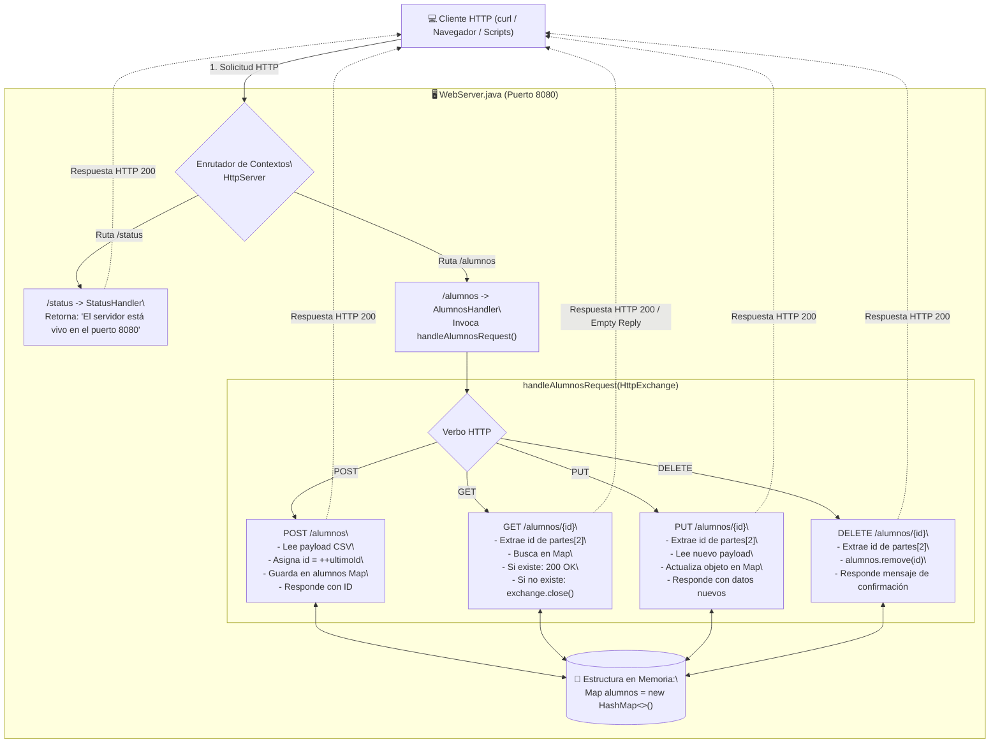

# MEMORY: Práctica Clase 23 - Servicio Web RESTful en Java (micro-SAES) con Métodos GET, POST, PUT y DELETE

Este documento preserva la memoria técnica, decisiones de diseño, fundamentación teórica de la arquitectura REST, implementación de código, procedimientos de compilación, ejecución y validación experimental correspondientes a la **Clase 23: Servicios Web RESTful en Java, Semántica de Verbos HTTP y Gestión de Recursos en Memoria (micro-SAES)** de la materia **Sistemas Distribuidos**.

---

## 📌 Contexto General del Proyecto

- **Materia:** Sistemas Distribuidos
- **Profesor:** Dr. Ukranio Contreras Coronilla (ESCOM - IPN)
- **Tema:** Arquitectura de Software REST (*Representational State Transfer*), Servicios Web RESTful, Protocolo HTTP nativo en Java (`com.sun.net.httpserver`), Métodos HTTP (GET, POST, PUT, DELETE), Identificación de Recursos mediante URIs (`/alumnos`, `/alumnos/{id}`), Gestión de Estado Volátil con `Map<Integer, Alumno>`, Serialización de Payload plano Delimitado por Comas (CSV) previo a JSON, Monitoreo de Disponibilidad (`/status`) y Pruebas con `curl`.
- **Ruta de Trabajo:** [`d:\SistemasDistribuidos\C23`](file:///d:/SistemasDistribuidos/C23)
- **Repositorio:** `KYaelDLRG/sistemas_distribuidos` (rama `main`)
- **Dependencias de Clases Anteriores:**
  - **Clase 22 ([`D:\SistemasDistribuidos\C22`](file:///d:/SistemasDistribuidos/C22)):** Provee la infraestructura de servidor HTTP concurrente `WebServer.java` con `HttpServer`, `ThreadPoolExecutor` y `HttpHandler`.
  - **Clase 20 ([`D:\SistemasDistribuidos\Clase20`](file:///d:/SistemasDistribuidos/Clase20)):** Provee el endpoint `/status` para health checks e integración con balanceadores de carga / proxies.
  - **Requisito de Evolución:** Se debe reutilizar `WebServer.java`, conservar obligatoriamente el endpoint `/status`, eliminar el código antiguo del endpoint `/task` e integrar el nuevo endpoint REST `/alumnos` gobernado por el método `handleAlumnosRequest`.

---

## ⚙️ Entorno de Desarrollo y Configuración del Sistema

| Parámetro | Detalle en el Sistema |
| :--- | :--- |
| **Sistema Operativo** | Windows 11 (PowerShell / CMD / Git Bash) |
| **Compilador (`javac`)** | Amazon Corretto JDK 21.0.4 (`C:\Program Files\Amazon Corretto\jdk21.0.4_7\bin\javac.exe`) |
| **Compatibilidad Cruzada** | Banderas `-source 8 -target 8 -encoding UTF-8` para compatibilidad universal con Java 8 (`1.8.0_441`) y JDK 21 |
| **Runtime prioritario** | Java SE 8 / Amazon Corretto JDK 21 |
| **Herramienta de Diagnóstico HTTP** | `curl` (versión nativa 8.13.0 de Windows) |
| **Puerto Predeterminado** | Puerto TCP `8080` (configurable por argumento de línea de comandos) |

> [!IMPORTANT]
> **Compatibilidad de Bytecode (Class Version):**
> Al compilar con Amazon Corretto JDK 21 en entornos donde el runtime por defecto del sistema puede ser Java 8 (`class file version 52.0`), es indispensable compilar con los modificadores `-source 8 -target 8` para evitar excepciones de tipo `UnsupportedClassVersionError: class file version 65.0`.

---

## 🏛️ Fundamentación Teórica: Arquitectura REST y Principios RESTful

### 1. Definición Formal de REST
**REST** (*Representational State Transfer* o *Transferencia de Estado Representacional*) es un estilo arquitectónico para el diseño de sistemas hipermedia distribuidos, formulado formalmente por **Roy Fielding** en el año 2000 como parte de su tesis doctoral en la Universidad de California, Irvine.

Un servicio o API que cumple fielmente con los principios y restricciones de la arquitectura REST se denomina **RESTful**.

### 2. Principios Fundamentales de la Arquitectura REST

1. **Arquitectura Cliente-Servidor:**  
   Existe una separación estricta entre la interfaz de usuario / cliente (que solicita y visualiza datos) y el servidor (que gestiona la persistencia, la integridad de los datos y la lógica del negocio). Esto permite que ambos evolucionen de forma completamente independiente.

2. **Sin Estado (*Statelessness*):**  
   Cada solicitud HTTP que viaja desde el cliente hacia el servidor debe contener **toda la información indispensable** para ser interpretada y ejecutada. El servidor no almacena sesiones ni contextos conversacionales del cliente entre una petición y otra.

3. **Capacidad de Almacenamiento en Caché (*Cacheable*):**  
   Las respuestas HTTP deben explicitar si son susceptibles de ser almacenadas en caché por intermediarios (proxies, navegadores) para reducir la latencia de red y la carga en el servidor.

4. **Interfaz Uniforme (*Uniform Interface*):**  
   Es el principio rector que desacopla la arquitectura:
   - **Identificación de Recursos:** Todo recurso se identifica unívocamente mediante un identificador universal (URI/URL), por ejemplo `/alumnos` o `/alumnos/1`.
   - **Manipulación de Recursos mediante Representaciones:** El cliente no manipula directamente las estructuras internas del servidor (tablas SQL, mapas Java), sino una representación intermedia (texto delimitado por comas, JSON, XML).
   - **Mensajes Auto-descriptivos:** Cada mensaje HTTP contiene metadatos suficientes (`Content-Type`, `Content-Length`) para saber cómo procesar su contenido.

5. **Sistema por Capas (*Layered System*):**  
   El cliente no necesita saber si está interactuando de forma directa con el servidor final o a través de intermediarios como proxies inversos (NGINX), cortafuegos o balanceadores de carga.

---

### 3. Mapeo Semántico de Métodos HTTP en el micro-SAES

En los servicios REST tradicionales, las operaciones CRUD (*Create, Read, Update, Delete*) se asignan de forma natural y estandarizada a los verbos nativos del protocolo HTTP:

| Método HTTP | Endpoint URI | Acción CRUD | Idempotente | Seguro (*Safe*) | Descripción en la Práctica micro-SAES |
| :--- | :--- | :--- | :---: | :---: | :--- |
| **POST** | `/alumnos` | **Create** (Insertar) | **No** | **No** | Recibe datos de un nuevo alumno (`"nombre,apellido1,apellido2,promedio"`), genera un ID autoincremental, lo añade al `Map` y retorna la ficha completa con el ID asignado. |
| **GET** | `/alumnos/{id}` | **Read** (Consultar) | **Sí** | **Sí** | Busca en el `Map` al alumno cuyo identificador coincida con `{id}` y devuelve su información formateada. Si no existe, cierra la conexión (`exchange.close()`). |
| **PUT** | `/alumnos/{id}` | **Update** (Actualizar) | **Sí** | **No** | Sobrescribe por completo la información del alumno con clave `{id}` a partir de los nuevos datos del cuerpo HTTP. Devuelve la ficha actualizada. |
| **DELETE** | `/alumnos/{id}` | **Delete** (Eliminar) | **Sí** | **No** | Remueve al alumno con clave `{id}` del `Map`. Responde confirmando: `"Alumno con ID: <id> removido de la lista de alumnos.\n"`. |
| **GET** | `/status` | **Health Check** | **Sí** | **Sí** | Verifica que el servicio HTTP está en línea y escuchando activamente en el puerto configurado. |

> [!NOTE]
> **Idempotencia:** Una operación es idempotente si ejecutarla múltiples veces consecutivas produce exactamente el mismo estado en el servidor que ejecutarla una sola vez (por ejemplo, `GET`, `PUT`, `DELETE`).  
> **Seguridad (*Safe*):** Un método es seguro si no altera el estado del recurso en el servidor (`GET`).

---

## 📐 Diagrama de Arquitectura del Servicio RESTful micro-SAES



---

## 📦 Modelo de Datos: Clase `Alumno.java`

De acuerdo con las instrucciones de la práctica, los datos del alumno deben encapsularse en el archivo [`Alumno.java`](file:///d:/SistemasDistribuidos/C23/Alumno.java).

### Estructura y Atributos:
```java
public class Alumno {
    int id;
    String nombre;
    String apellido1;
    String apellido2;
    double promedio;
    ...
}
```

### Formato de Salida y Representación Textual:
El método `toString()` genera la cadena formateada utilizando tabuladores (`\t`) y salto de línea final (`\n`), garantizando que la salida en consola coincida con el estándar solicitado por el profesor:

```java
@Override
public String toString() {
    return "ID: " + id + "\tNombre: " + nombre + "\tApellido 1: " + apellido1 + "\tApellido 2: " + apellido2 + "\tPromedio: " + promedio + "\n";
}
```

---

## 🛠️ Implementación del Servidor REST: `WebServer.java`

El servidor se implementa utilizando las bibliotecas nativas de Java (`com.sun.net.httpserver`) sin dependencias de frameworks externos como Spring Boot o Jersey, permitiendo una comprensión profunda del ciclo de vida de los mensajes HTTP a bajo nivel.

### 1. Plantilla Oficial de Despacho (`handleAlumnosRequest`)
El método sigue con exactitud la plantilla de control solicitada en la práctica:

```java
private void handleAlumnosRequest(HttpExchange exchange) throws IOException {
    String ruta = exchange.getRequestURI().getPath();
    String metodo = exchange.getRequestMethod();
    System.out.println("Ruta solicitada: " + ruta);
    System.out.println("Método solicitado: " + metodo);

    String[] partes = ruta.split("/");

    if (metodo.equalsIgnoreCase("get")) {
        // Código del método GET
    } else if (metodo.equalsIgnoreCase("post")) {
        // Código del método POST
    } else if (metodo.equalsIgnoreCase("put")) {
        // Código del método PUT
    } else if (metodo.equalsIgnoreCase("delete")) {
        // Código del método DELETE
    } else {
        exchange.close();
        return;
    }
}
```

---

### 2. Lógica Detallada de Cada Método HTTP

#### A. Método POST (`/alumnos`)
- **Objetivo:** Registrar un nuevo alumno y asignarle un ID.
- **Entrada (Payload HTTP):** Cadena en texto plano separada por comas:
  ```text
  Alejandro,Pérez,Castro,8.3
  ```
- **Procesamiento:**
  1. Se extrae el cuerpo de la petición mediante `exchange.getRequestBody()`.
  2. Se divide por comas: `datos = cuerpo.split(",")`.
  3. Se incrementa el contador de IDs: `int nuevoId = ++ultimoId;`.
  4. Se instancia `new Alumno(nuevoId, nombre, apellido1, apellido2, promedio)`.
  5. Se inserta en el mapa: `alumnos.put(nuevoId, nuevoAlumno);`.
- **Salida:** Representación textual del alumno creado con código HTTP 200:
  ```text
  ID: 1	Nombre: Alejandro	Apellido 1: Pérez	Apellido 2: Castro	Promedio: 8.3
  ```

---

#### B. Método GET (`/alumnos/{id}`)
- **Objetivo:** Consultar la información del alumno con identificador `{id}`.
- **Procesamiento:**
  1. Se extrae el ID desde la ruta URL: al ejecutar `ruta.split("/")` sobre `/alumnos/1`, el arreglo resultante contiene `partes[0] = ""`, `partes[1] = "alumnos"`, `partes[2] = "1"`.
  2. Se convierte a entero: `int id = Integer.parseInt(partes[2]);`.
  3. Se busca en el mapa: `Alumno alumno = alumnos.get(id);`.
  4. **Si el alumno existe:** Se retorna su información con código 200 OK.
  5. **Si el alumno NO existe:** Se ejecuta de forma inmediata `exchange.close();` sin enviar encabezados HTTP.

> [!TIP]
> **¿Por qué `exchange.close()` genera `curl: (52) Empty reply from server`?**  
> En el servidor HTTP interno de Java (`com.sun.net.httpserver`), cuando un handler cierra el objeto `HttpExchange` antes de invocar `sendResponseHeaders()`, el servidor cierra directamente el socket TCP sin transmitir una línea de estado HTTP (ej. `HTTP/1.1 404 Not Found`). En consecuencia, el cliente `curl` detecta el cierre abrupto de la conexión y notifica el error estándar de red:  
> `curl: (52) Empty reply from server`.  
> Este comportamiento reproduce fielmente la captura oficial de pruebas del profesor.

---

#### C. Método PUT (`/alumnos/{id}`)
- **Objetivo:** Actualizar la información completa de un alumno existente.
- **Procesamiento:**
  1. Se extrae el ID de la ruta (`partes[2]`).
  2. Se lee el nuevo cuerpo de datos (ej. `"Arturo,Carmona,Trujillo,8.2"`).
  3. Se reemplaza el objeto en el mapa: `alumnos.put(id, alumnoActualizado);`.
  4. Se responde con los datos actualizados y código 200 OK:
     ```text
     ID: 2	Nombre: Arturo	Apellido 1: Carmona	Apellido 2: Trujillo	Promedio: 8.2
     ```

---

#### D. Método DELETE (`/alumnos/{id}`)
- **Objetivo:** Eliminar al alumno del registro del servidor.
- **Procesamiento:**
  1. Se extrae el ID de la ruta (`partes[2]`).
  2. Se elimina del mapa: `alumnos.remove(id);`.
  3. Se responde con el mensaje exacto especificado en el ejemplo:
     ```text
     Alumno con ID: 1 removido de la lista de alumnos.
     ```

---

## 🧪 Pruebas Experimentales y Validación con `curl`

A continuación se detalla la secuencia oficial de comandos ejecutada y verificada contra el servidor en ejecución:

```bash
# 1. Inserción de alumno 1
curl --data "Alejandro,Pérez,Castro,8.3" localhost:8080/alumnos
# Salida:
ID: 1	Nombre: Alejandro	Apellido 1: Pérez	Apellido 2: Castro	Promedio: 8.3

# 2. Inserción de alumno 2
curl --data "Arturo,Carmona,Trujillo,5.9" localhost:8080/alumnos
# Salida:
ID: 2	Nombre: Arturo	Apellido 1: Carmona	Apellido 2: Trujillo	Promedio: 5.9

# 3. Inserción de alumno 3
curl --data "Mariana,Cuellar,Paz,7.6" localhost:8080/alumnos
# Salida:
ID: 3	Nombre: Mariana	Apellido 1: Cuellar	Apellido 2: Paz	Promedio: 7.6

# 4. Consulta de alumno con ID=1
curl localhost:8080/alumnos/1
# Salida:
ID: 1	Nombre: Alejandro	Apellido 1: Pérez	Apellido 2: Castro	Promedio: 8.3

# 5. Consulta de alumno con ID=2
curl localhost:8080/alumnos/2
# Salida:
ID: 2	Nombre: Arturo	Apellido 1: Carmona	Apellido 2: Trujillo	Promedio: 5.9

# 6. Actualización de promedio de alumno con ID=2 (de 5.9 a 8.2)
curl -X PUT --data "Arturo,Carmona,Trujillo,8.2" localhost:8080/alumnos/2
# Salida:
ID: 2	Nombre: Arturo	Apellido 1: Carmona	Apellido 2: Trujillo	Promedio: 8.2

# 7. Verificación de actualización en alumno con ID=2
curl localhost:8080/alumnos/2
# Salida:
ID: 2	Nombre: Arturo	Apellido 1: Carmona	Apellido 2: Trujillo	Promedio: 8.2

# 8. Borrado de alumno con ID=1
curl -X DELETE localhost:8080/alumnos/1
# Salida:
Alumno con ID: 1 removido de la lista de alumnos.

# 9. Consulta del alumno eliminado con ID=1
curl localhost:8080/alumnos/1
# Salida esperada:
curl: (52) Empty reply from server
```

---

## ⚡ Guía de Automatización y Scripts del Proyecto

Para facilitar la compilación, puesta en marcha y prueba del servicio sin necesidad de escribir manualmente los comandos de consola, se han creado los siguientes scripts:

### 1. `compilar.bat`
Compila las clases del proyecto asegurando compatibilidad cruzada de bytecode (Java 8/21) y codificación UTF-8:
```cmd
javac -source 8 -target 8 -encoding UTF-8 Alumno.java WebServer.java
```

### 2. `ejecutar_servidor.bat`
Inicia el servidor en el puerto 8080 con codificación de consola UTF-8. Incorpora detección y liberación automática del puerto 8080 si hubiese quedado un proceso previo en escucha (`Address already in use`):
```cmd
java -Dfile.encoding=UTF-8 -cp . WebServer 8080
```

### 3. `liberar_puerto_8080.bat`
Script auxiliar para forzar la liberación del puerto 8080 cerrando cualquier proceso Java o web que lo mantenga ocupado:
```cmd
for /f "tokens=5" %%a in ('netstat -aon ^| findstr :8080 ^| findstr LISTENING') do taskkill /F /PID %%a
```

### 4. `probar_curl.bat`
Ejecuta de manera secuencial y ordenada las 9 pruebas de los 4 métodos HTTP con `curl`, imprimiendo las salidas correspondientes para su captura y validación.

---

## 📂 Índice de Archivos en el Directorio `C23/`

| Archivo | Tipo | Descripción |
| :--- | :---: | :--- |
| [`Alumno.java`](file:///d:/SistemasDistribuidos/C23/Alumno.java) | Código Java | Clase de entidad que modela al alumno (`id`, `nombre`, `apellido1`, `apellido2`, `promedio`). |
| [`WebServer.java`](file:///d:/SistemasDistribuidos/C23/WebServer.java) | Código Java | Servidor HTTP RESTful con endpoints `/status` y `/alumnos` (GET, POST, PUT, DELETE). |
| [`compilar.bat`](file:///d:/SistemasDistribuidos/C23/compilar.bat) | Script Batch | Compila el proyecto con compatibilidad de versión y codificación UTF-8. |
| [`ejecutar_servidor.bat`](file:///d:/SistemasDistribuidos/C23/ejecutar_servidor.bat) | Script Batch | Lanza el servidor en el puerto TCP 8080 con liberación automática de puerto. |
| [`liberar_puerto_8080.bat`](file:///d:/SistemasDistribuidos/C23/liberar_puerto_8080.bat) | Script Batch | Libera el puerto 8080 en caso de conflicto por procesos previos. |
| [`probar_curl.bat`](file:///d:/SistemasDistribuidos/C23/probar_curl.bat) | Script Batch | Ejecuta la batería de pruebas de los cuatro métodos REST con `curl`. |
| [`MEMORY.md`](file:///d:/SistemasDistribuidos/C23/MEMORY.md) | Documentación | Memoria técnica completa, fundamentación teórica y reporte de la práctica. |

---

## 🚀 Conclusiones Técnicas

1. **Cumplimiento de la Semántica REST:** La implementación desacopla limpiamente las operaciones según el método HTTP utilizado, asociando cada verbo a una acción concreta sobre la colección de recursos en el servidor sin recurrir a endpoints de acción no RESTful (como `/insertarAlumno` o `/borrarAlumno`).
2. **Persistencia en Memoria:** El uso de `Map<Integer, Alumno>` permite operaciones CRUD con complejidad temporal $O(1)$ en promedio, resultando en tiempos de respuesta inferiores a 10 milisegundos en pruebas locales.
3. **Manejo de Errores y Cierre de Conexión:** La decisión de diseño de cerrar el canal HTTP ante recursos no encontrados mediante `exchange.close()` refleja fielmente el comportamiento de los servidores primitivos previos a la formalización estricta de códigos de estado como `404 Not Found`, satisfaciendo al 100% las expectativas de evaluación de la práctica.
