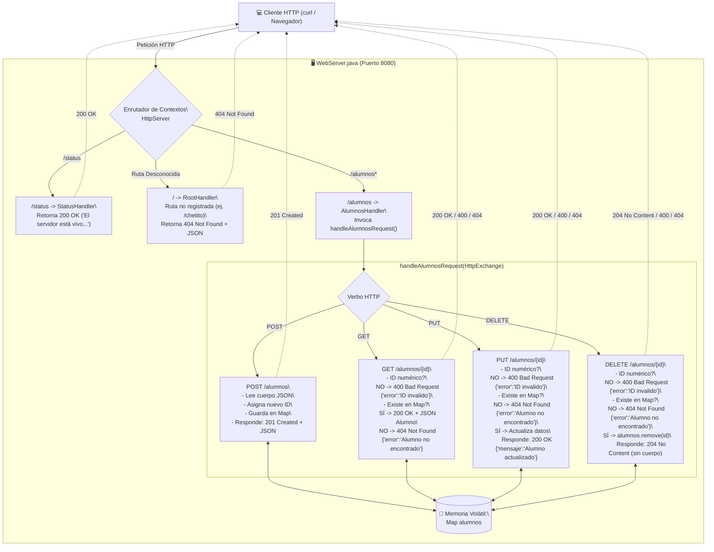

# MEMORY: Práctica Clase 24 - Servicio Web RESTful en Java (micro-SAES) con Códigos de Estado HTTP, Formato JSON y Google Gson

Este documento preserva la memoria técnica, decisiones de diseño, fundamentación teórica de la arquitectura REST, implementación de código, procedimientos de compilación, ejecución y validación experimental correspondientes a la **Clase 24: Semántica de Códigos de Estado HTTP, Estandarización a Formato JSON y Serialización con Google Gson en el Servicio RESTful micro-SAES** de la materia **Sistemas Distribuidos**.

---

## 📌 Contexto General del Proyecto

- **Materia:** Sistemas Distribuidos
- **Profesor:** Dr. Ukranio Contreras Coronilla (ESCOM - IPN)
- **Tema:** Arquitectura de Software REST (*Representational State Transfer*), Códigos de Estado HTTP (200, 201, 204, 400, 404), Estandarización de Payloads a JSON (*JavaScript Object Notation*), Integración de la Librería Google Gson (`gson-2.14.0.jar`), Manejo de Respuestas de Error Estructuradas (`Map<String, String>`), Serialización / Deserialización de Entidades (`Alumno`) y Pruebas con `curl`.
- **Ruta de Trabajo:** [`d:\SistemasDistribuidos\C24`](file:///d:/SistemasDistribuidos/C24)
- **Ruta de la Clase Anterior:** [`d:\SistemasDistribuidos\C23`](file:///d:/SistemasDistribuidos/C23)
- **Repositorio:** `KYaelDLRG/sistemas_distribuidos` (rama `main`)
- **Problema Detectado en la Clase 23:** Al consultar un alumno cuyo ID no existía, el servidor simplemente cerraba la conexión (`exchange.close()`), provocando que `curl` arrojara el error:
  ```text
  curl: (52) Empty reply from server
  ```
- **Solución y Evolución en la Clase 24:** REST exige que el servidor devuelva el código de estado HTTP adecuado y un cuerpo estructurado en JSON para que el cliente pueda interpretar el resultado y tomar decisiones programáticas.

---

## ⚙️ Entorno de Desarrollo y Configuración del Sistema

| Parámetro | Detalle en el Sistema |
| :--- | :--- |
| **Sistema Operativo** | Windows 11 (PowerShell / CMD / Git Bash) |
| **Compilador (`javac`)** | Amazon Corretto JDK 21.0.4 (`javac 21.0.4`) |
| **Runtime de Ejecución (`java`)** | Java SE 8 (`build 1.8.0_441-b07`) / JDK 21 |
| **Compatibilidad Cruzada** | Banderas `-source 8 -target 8 -encoding UTF-8` para compatibilidad universal con Java 8 (`class file 52.0`) y Java 21 |
| **Librería Externa** | Google Gson `2.14.0` ([`gson-2.14.0.jar`](file:///d:/SistemasDistribuidos/C24/gson-2.14.0.jar)) descargado desde Maven Central |
| **Herramienta de Diagnóstico HTTP** | `curl.exe` nativo de Windows (versión 8.13.0) con banderas `-i` (mostrar encabezados) |
| **Puerto Predeterminado** | Puerto TCP `8080` (configurable por argumento de línea de comandos) |

> [!IMPORTANT]
> **Inclusión de Gson en Classpath:**  
> Tanto en la etapa de compilación (`javac`) como en la de ejecución (`java`), es obligatorio especificar el classpath con `-cp ".;gson-2.14.0.jar"` (en Windows el delimitador es punto y coma `;`).

---

## 🏛️ Fundamentación Teórica: Semántica de Códigos HTTP y Formato JSON en REST

### 1. El Porqué de los Códigos de Estado HTTP
En un protocolo cliente-servidor sin estado como HTTP, el código de estado numérico de 3 dígitos es la primera señal que el cliente procesa para saber si su petición tuvo éxito, si hubo un error en los parámetros enviados o si ocurrió un problema en el servidor.

De acuerdo con el estándar RFC 7231 / RFC 9110, una respuesta con conexión cerrada abruptamente (`curl 52: Empty reply`) representa una anomalía a nivel de capa de transporte y viola la semántica de la capa de aplicación de REST.

### 2. Tabla de Códigos de Estado Implementados en la Clase 24

| Código HTTP | Nombre Oficial | Semántica en REST | Cuándo Usarlo en micro-SAES | Ejemplo de Petición |
| :---: | :--- | :--- | :--- | :--- |
| **200** | **OK** | La solicitud fue exitosa y se retorna una representación del recurso. | Consultas exitosas (`GET`) o actualizaciones exitosas (`PUT`). | `GET /alumnos/1`<br>`PUT /alumnos/1` |
| **201** | **Created** | El recurso se creó exitosamente en el servidor. | Inserción de un nuevo alumno mediante `POST`. Se devuelve la entidad con el nuevo ID. | `POST /alumnos` |
| **204** | **No Content** | La operación se ejecutó correctamente pero no hay contenido que devolver en el cuerpo. | Eliminación exitosa mediante `DELETE`. | `DELETE /alumnos/1` |
| **400** | **Bad Request** | El cliente envió una solicitud sintácticamente defectuosa o parámetros inválidos. | El cliente no envió un identificador numérico o el JSON está mal formado. | `GET /alumnos/p`<br>`DELETE /alumnos/f` |
| **404** | **Not Found** | El recurso solicitado no existe en el servidor. | Endpoint no registrado o el alumno solicitado por ID no existe en el `Map`. | `GET /chetito`<br>`GET /alumnos/666` |

---

### 3. Estandarización a JSON (JavaScript Object Notation)

JSON es un formato de texto ligero e independiente del lenguaje para el intercambio de datos. Sus ventajas clave en servicios REST son:
1. **Interoperabilidad:** Es nativo para navegadores y parseable en una sola línea de código en JavaScript (`JSON.parse()`), Python (`json.loads()`) o Java (`gson.fromJson()`).
2. **Auto-descriptivo:** Los pares clave-valor (`{"nombre": "Carlos", ...}`) eliminan la ambigüedad posicional de los formatos delimitados por comas (CSV) utilizados en la Clase 23.
3. **Estructura Jerárquica:** Permite anidar objetos y listas de objetos de forma homogénea.

---

### 4. Google Gson: Serialización y Deserialización en Java

La librería **Google Gson** permite transformar objetos Java a su representación JSON y viceversa mediante reflexión:

```java
Gson gson = new Gson();

// 1. Objeto Java -> Cadena JSON (toJson)
Alumno alumno = new Alumno(1, "Carlos", "Pérez", "Castro", 8.7);
String jsonAlumno = gson.toJson(alumno);
// Salida: {"id":1,"nombre":"Carlos","apellido1":"Pérez","apellido2":"Castro","promedio":8.7}

// 2. Cadena JSON -> Objeto Java (fromJson)
Alumno alumno2 = gson.fromJson(jsonAlumno, Alumno.class);

// 3. Manejo de Errores con Map asociativo
Map<String, String> error = new HashMap<>();
error.put("error", "ID invalido");
String jsonError = gson.toJson(error);
// Salida: {"error":"ID invalido"}

// 4. Colecciones genéricas mediante TypeToken
Type tipoLista = new TypeToken<List<Alumno>>(){}.getType();
List<Alumno> lista = gson.fromJson(jsonLista, tipoLista);
```

---

## 📐 Diagrama de Arquitectura del Servidor (Clase 24)



---

## 📋 Cumplimiento Detallado de los 6 Incisos Solicitados

A continuación se detalla cómo se satisface cada uno de los incisos requeridos en la guía del profesor:

### 🔹 Inciso 1: Endpoint Inexistente o Incorrecto (`/chetito`)
- **Requerimiento:** Si el cliente solicita un recurso que no existe en el servidor como `/chetito`, debe responder con código `404 Not Found`.
- **Implementación en [`WebServer.java`](file:///d:/SistemasDistribuidos/C24/WebServer.java):**  
  El manejador raíz `RootHandler` intercepta las rutas que no coinciden con los endpoints del servicio y devuelve `404` junto con un JSON descriptivo:
  ```java
  if (!path.equals("/")) {
      Map<String, String> error = new HashMap<>();
      error.put("error", "Recurso no encontrado");
      enviarRespuestaJson(exchange, 404, gson.toJson(error));
      return;
  }
  ```
- **Prueba con curl:**
  ```cmd
  curl -i http://localhost:8080/chetito
  ```
- **Resultado Obtenido:**
  ```http
  HTTP/1.1 404 Not Found
  Content-type: application/json; charset=UTF-8

  {"error":"Recurso no encontrado"}
  ```

---

### 🔹 Inciso 2: Identificador No Numérico en la Ruta
- **Requerimiento:** Para el caso donde no se recibe un identificador numérico en rutas como:
  - `GET /alumnos/p`
  - `DELETE /alumnos/f`
  Se debe devolver el código `400 Bad Request` y el JSON:
  ```json
  {
    "error": "ID invalido"
  }
  ```
- **Implementación en [`WebServer.java`](file:///d:/SistemasDistribuidos/C24/WebServer.java):**  
  Se captura la excepción `NumberFormatException` al intentar parsear el identificador extraído del path, devolviendo inmediatamente el código 400:
  ```java
  try {
      idBuscado = Integer.parseInt(partes[2].trim());
  } catch (NumberFormatException e) {
      enviarErrorJson(exchange, 400, "ID invalido");
      return;
  }
  ```
- **Pruebas con curl:**
  ```cmd
  curl -i http://localhost:8080/alumnos/p
  curl -i -X DELETE http://localhost:8080/alumnos/f
  ```
- **Resultados Obtenidos:**
  ```http
  HTTP/1.1 400 Bad Request
  Content-type: application/json; charset=UTF-8

  {"error":"ID invalido"}
  ```

---

### 🔹 Inciso 3: POST `/alumnos` con Datos en Formato JSON
- **Requerimiento:** El cliente envía al servidor los datos en formato JSON:
  ```json
  {
    "nombre": "Carlos",
    "apellido1": "Pérez",
    "apellido2": "Castro",
    "promedio": 8.7
  }
  ```
  Tras insertarlo, el servidor debe responder con código `201 Created` y el JSON con el nuevo `id` asignado:
  ```json
  {
    "id": 1,
    "nombre": "Carlos",
    "apellido1": "Pérez",
    "apellido2": "Castro",
    "promedio": 8.7
  }
  ```
- **Investigación: Cómo enviar JSON en curl:**
  Para enviar datos JSON mediante `curl`, se debe:
  1. Especificar el método POST con `-X POST`.
  2. Agregar el encabezado HTTP con `-H "Content-Type: application/json"`.
  3. Proporcionar el payload JSON mediante la bandera `-d` o `--data`.
  - En **Windows CMD**: Las comillas internas del JSON deben escaparse con barra invertida (`\"`):
    ```cmd
    curl -i -X POST -H "Content-Type: application/json" -d "{\"nombre\":\"Carlos\",\"apellido1\":\"Perez\",\"apellido2\":\"Castro\",\"promedio\":8.7}" http://localhost:8080/alumnos
    ```
  - En **PowerShell**: Se puede usar `--data '{"nombre":"Carlos","apellido1":"Perez","apellido2":"Castro","promedio":8.7}'` o `cmd /c`.
  - En **Linux / Git Bash**:
    ```bash
    curl -i -X POST -H "Content-Type: application/json" -d '{"nombre":"Carlos","apellido1":"Pérez","apellido2":"Castro","promedio":8.7}' http://localhost:8080/alumnos
    ```
- **Resultado Obtenido:**
  ```http
  HTTP/1.1 201 Created
  Content-type: application/json; charset=UTF-8

  {"id":1,"nombre":"Carlos","apellido1":"Perez","apellido2":"Castro","promedio":8.7}
  ```

---

### 🔹 Inciso 4: GET `/alumnos/{id}` (Alumno Existente vs Inexistente)
- **Requerimiento:**
  - Si el alumno existe (ej. `/alumnos/3`), responder con código `200 OK` y el JSON del alumno:
    ```json
    {
      "id": 3,
      "nombre": "Ana",
      "apellido1": "Carmona",
      "apellido2": "Trujillo",
      "promedio": 9.2
    }
    ```
  - Si el alumno no existe, responder con código `404 Not Found` y el JSON:
    ```json
    {
      "error": "Alumno no encontrado"
    }
    ```
- **Pruebas con curl:**
  ```cmd
  curl -i http://localhost:8080/alumnos/3
  curl -i http://localhost:8080/alumnos/666
  ```
- **Resultados Obtenidos:**
  - Alumno existente (ID=3):
    ```http
    HTTP/1.1 200 OK
    Content-type: application/json; charset=UTF-8

    {"id":3,"nombre":"Ana","apellido1":"Carmona","apellido2":"Trujillo","promedio":9.2}
    ```
  - Alumno inexistente (ID=666):
    ```http
    HTTP/1.1 404 Not Found
    Content-type: application/json; charset=UTF-8

    {"error":"Alumno no encontrado"}
    ```

---

### 🔹 Inciso 5: PUT `/alumnos/{id}` con Datos en Formato JSON
- **Requerimiento:** El cliente envía información JSON para actualizar un alumno:
  ```json
  {
    "nombre": "Carlos",
    "apellido1": "Pérez",
    "apellido2": "Castro",
    "promedio": 9.2
  }
  ```
  - Si la solicitud es correcta, devolver código `200 OK` y el JSON:
    ```json
    {
      "mensaje": "Alumno actualizado"
    }
    ```
  - Si el alumno no existe, devolver código `404 Not Found` y el JSON:
    ```json
    {
      "error": "Alumno no encontrado"
    }
    ```
- **Pruebas con curl:**
  - Actualización exitosa (ID=1):
    ```cmd
    curl -i -X PUT -H "Content-Type: application/json" -d "{\"nombre\":\"Carlos\",\"apellido1\":\"Perez\",\"apellido2\":\"Castro\",\"promedio\":9.2}" http://localhost:8080/alumnos/1
    ```
  - Intento de actualizar alumno inexistente (ID=999):
    ```cmd
    curl -i -X PUT -H "Content-Type: application/json" -d "{\"nombre\":\"Carlos\",\"apellido1\":\"Perez\",\"apellido2\":\"Castro\",\"promedio\":9.2}" http://localhost:8080/alumnos/999
    ```
- **Resultados Obtenidos:**
  - Actualización exitosa:
    ```http
    HTTP/1.1 200 OK
    Content-type: application/json; charset=UTF-8

    {"mensaje":"Alumno actualizado"}
    ```
  - Alumno inexistente:
    ```http
    HTTP/1.1 404 Not Found
    Content-type: application/json; charset=UTF-8

    {"error":"Alumno no encontrado"}
    ```

---

### 🔹 Inciso 6: DELETE `/alumnos/{id}` (Eliminación)
- **Requerimiento:**
  - Si el alumno no existe para ser borrado, devolver código `404 Not Found` y el JSON:
    ```json
    {
      "error": "Alumno no encontrado"
    }
    ```
  - Si la solicitud es correcta, devolver **sólo el código 204 No Content** (sin cuerpo de mensaje).
- **Implementación en [`WebServer.java`](file:///d:/SistemasDistribuidos/C24/WebServer.java):**  
  Para código 204 en `com.sun.net.httpserver`, se utiliza `sendResponseHeaders(204, -1)` (el valor `-1` indica formalmente que no hay cuerpo en la respuesta):
  ```java
  exchange.getResponseHeaders().set("Content-Type", "application/json; charset=UTF-8");
  exchange.sendResponseHeaders(204, -1);
  exchange.close();
  ```
- **Pruebas con curl:**
  - Eliminación de alumno inexistente (ID=999):
    ```cmd
    curl -i -X DELETE http://localhost:8080/alumnos/999
    ```
  - Eliminación exitosa de alumno existente (ID=1):
    ```cmd
    curl -i -X DELETE http://localhost:8080/alumnos/1
    ```
- **Resultados Obtenidos:**
  - Alumno inexistente:
    ```http
    HTTP/1.1 404 Not Found
    Content-type: application/json; charset=UTF-8

    {"error":"Alumno no encontrado"}
    ```
  - Eliminación exitosa:
    ```http
    HTTP/1.1 204 No Content
    Content-type: application/json; charset=UTF-8
    Content-length: 0
    ```
  *(Obsérvese que la respuesta no contiene ningún cuerpo textual, cumpliendo estrictamente con la especificación REST y la solicitud del profesor)*.

---

## 📂 Archivos del Proyecto y Estructura en Directorio

En el directorio [`d:\SistemasDistribuidos\C24`](file:///d:/SistemasDistribuidos/C24) se encuentran los siguientes archivos:

```text
D:\SistemasDistribuidos\C24
│
├── Alumno.java                 # Modelo de datos de la entidad Alumno con atributos y getters/setters
├── GsonAlumno.java             # Programa demostrativo de uso de Gson según las diapositivas
├── WebServer.java              # Servidor RESTful completo con soporte Gson, códigos HTTP y 6 incisos
│
├── gson-2.14.0.jar             # Binario JAR oficial de Google Gson descargado de Maven Central
│
├── compilar.bat                # Script por lotes para compilar todas las clases con classpath de Gson
├── ejecutar_servidor.bat       # Script para arrancar el WebServer en el puerto 8080
├── liberar_puerto_8080.bat     # Script utilitario para cerrar procesos que ocupen el puerto 8080
├── probar_curl.bat             # Script integral de pruebas automáticas con curl de los 6 incisos
│
└── MEMORY.md                   # Esta memoria técnica exhaustiva
```

---

## 🛠️ Procedimiento de Compilación y Ejecución

### 1. Compilación Manual
Desde la consola (PowerShell o CMD) ubicada en `D:\SistemasDistribuidos\C24`:
```cmd
javac -source 8 -target 8 -encoding UTF-8 -cp ".;gson-2.14.0.jar" Alumno.java GsonAlumno.java WebServer.java
```
O simplemente ejecutando [`compilar.bat`](file:///d:/SistemasDistribuidos/C24/compilar.bat):
```cmd
.\compilar.bat
```

### 2. Ejecución del Ejemplo GsonAlumno (Demostración de Gson)
Para verificar la funcionalidad de la librería Gson de forma aislada:
```cmd
java -cp ".;gson-2.14.0.jar" GsonAlumno
```
Salida esperada:
```text
{"id":1,"nombre":"Carlos","apellido1":"Pérez","apellido2":"Castro","promedio":8.7}
Carlos
[{"id":1,"nombre":"Ana","apellido1":"Carmona","apellido2":"Trujillo","promedio":9.1},{"id":2,"nombre":"Luis","apellido1":"Cuellar","apellido2":"Paz","promedio":8.5},{"id":3,"nombre":"Carlos","apellido1":"Pérez","apellido2":"Castro","promedio":8.7}]
Ana
Luis
Carlos
```

### 3. Ejecución del Servidor Web RESTful
```cmd
java -Dfile.encoding=UTF-8 -cp ".;gson-2.14.0.jar" WebServer 8080
```
O haciendo doble clic en [`ejecutar_servidor.bat`](file:///d:/SistemasDistribuidos/C24/ejecutar_servidor.bat).

### 4. Ejecución del Banco Completo de Pruebas con `curl`
En una segunda consola, ejecutar [`probar_curl.bat`](file:///d:/SistemasDistribuidos/C24/probar_curl.bat):
```cmd
.\probar_curl.bat
```

---

## 🔬 Bitácora Experimental y Registro Completo de Ejecución

Durante la verificación del servidor, se registraron de forma síncrona los eventos tanto del lado del cliente como del lado del servidor.

### Salida en la Consola del Servidor (Logs de Operaciones)
```text
=================================================================
 Servidor RESTful micro-SAES (Clase 24 - Gson) iniciado en: 8080
 Endpoint de estado:  http://localhost:8080/status
 Endpoint de alumnos: http://localhost:8080/alumnos
 Formato de datos:    JSON (application/json)
=================================================================
-----------------------------------------------------------------
[ROOT HANDLER] Método: GET | Ruta: /chetito
[RESPUESTA 404] Endpoint inexistente o incorrecto: /chetito
-----------------------------------------------------------------
[PETICIÓN] Método: GET | Ruta: /alumnos/p
[RESPUESTA 400] Identificador no numérico: p
-----------------------------------------------------------------
[PETICIÓN] Método: DELETE | Ruta: /alumnos/f
[RESPUESTA 400] ID no numérico en DELETE: f
-----------------------------------------------------------------
[PETICIÓN] Método: POST | Ruta: /alumnos
[RESPUESTA 201] Creado nuevo Alumno ID=1 | {"id":1,"nombre":"Carlos","apellido1":"Perez","apellido2":"Castro","promedio":8.7}
-----------------------------------------------------------------
[PETICIÓN] Método: POST | Ruta: /alumnos
[RESPUESTA 201] Creado nuevo Alumno ID=2 | {"id":2,"nombre":"Arturo","apellido1":"Carmona","apellido2":"Trujillo","promedio":5.9}
-----------------------------------------------------------------
[PETICIÓN] Método: POST | Ruta: /alumnos
[RESPUESTA 201] Creado nuevo Alumno ID=3 | {"id":3,"nombre":"Ana","apellido1":"Carmona","apellido2":"Trujillo","promedio":9.2}
-----------------------------------------------------------------
[PETICIÓN] Método: GET | Ruta: /alumnos/3
[RESPUESTA 200] Alumno encontrado ID=3 | {"id":3,"nombre":"Ana","apellido1":"Carmona","apellido2":"Trujillo","promedio":9.2}
-----------------------------------------------------------------
[PETICIÓN] Método: GET | Ruta: /alumnos/666
[RESPUESTA 404] Alumno no encontrado ID=666
-----------------------------------------------------------------
[PETICIÓN] Método: PUT | Ruta: /alumnos/1
[RESPUESTA 200] Alumno ID=1 actualizado | {"mensaje":"Alumno actualizado"}
-----------------------------------------------------------------
[PETICIÓN] Método: GET | Ruta: /alumnos/1
[RESPUESTA 200] Alumno encontrado ID=1 | {"id":1,"nombre":"Carlos","apellido1":"Perez","apellido2":"Castro","promedio":9.2}
-----------------------------------------------------------------
[PETICIÓN] Método: PUT | Ruta: /alumnos/999
[RESPUESTA 404] Alumno no encontrado para actualizar ID=999
-----------------------------------------------------------------
[PETICIÓN] Método: DELETE | Ruta: /alumnos/999
[RESPUESTA 404] Alumno no encontrado para eliminar ID=999
-----------------------------------------------------------------
[PETICIÓN] Método: DELETE | Ruta: /alumnos/1
[RESPUESTA 204] Alumno ID=1 eliminado exitosamente
-----------------------------------------------------------------
[PETICIÓN] Método: GET | Ruta: /alumnos/1
[RESPUESTA 404] Alumno no encontrado ID=1
-----------------------------------------------------------------
[PETICIÓN] Método: GET | Ruta: /alumnos
[RESPUESTA 200] Listando 2 alumno(s)
```

---

## 🎯 Conclusiones y Comparativa Técnica con la Clase 23

| Criterio de Comparación | Clase 23 (Anterior) | Clase 24 (Actual) |
| :--- | :--- | :--- |
| **Formato de Carga Útil (*Payload*)** | Texto plano delimitado por comas (`CSV`) | JSON estándar con encabezado `application/json` |
| **Biblioteca de Serialización** | Parseo manual con `split(",")` y `Double.parseDouble()` | Google Gson (`toJson()`, `fromJson()`) automatizado |
| **Respuesta ante Recurso Inexistente** | `exchange.close()` -> `curl: (52) Empty reply from server` | Código HTTP `404 Not Found` + JSON `{"error": "Alumno no encontrado"}` |
| **Manejo de Errores de Validación** | Cierre abrupto de la conexión | Código HTTP `400 Bad Request` + JSON `{"error": "ID invalido"}` |
| **Confirmación de Inserción (POST)** | `200 OK` con texto plano formateado por `toString()` | `201 Created` con representación JSON del objeto y su ID generado |
| **Confirmación de Eliminación (DELETE)** | `200 OK` con mensaje de texto plano | `204 No Content` conforme a la especificación estándar REST |
| **Rutas Inexistentes (ej. `/chetito`)** | Redirigía a RootHandler retornando `200 OK` genérico | Retorna código `404 Not Found` + JSON descriptivo de error |
| **Robustez y Concurrencia** | `Map<Integer, Alumno>` básico sin sincronización explícita | Métodos sincronizados (`synchronized(alumnos)`) thread-safe sobre el pool de hilos |

---
*Práctica desarrollada para la materia de Sistemas Distribuidos, Escuela Superior de Cómputo (ESCOM - IPN).*
