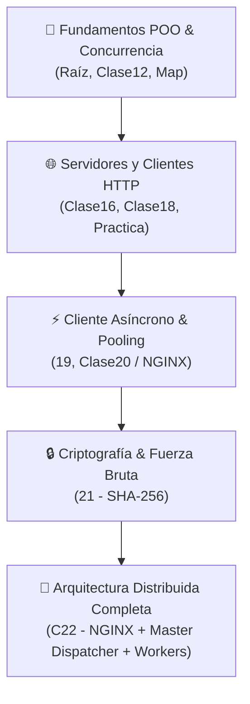

# MEMORY: Repositorio General de Sistemas Distribuidos

Este documento centraliza la memoria técnica, arquitectura de módulos, configuración del entorno de desarrollo, inventario de prácticas y directrices de sincronización para el repositorio general de **Sistemas Distribuidos**.

---

## 📌 1. Información General del Proyecto

- **Materia:** Sistemas Distribuidos
- **Institución:** Escuela Superior de Cómputo (ESCOM - IPN)
- **Profesor:** Dr. Ukranio Contreras Coronilla
- **Ruta de Trabajo Local:** `c:\Users\kaleb\SistemasDistribuidos`
- **Repositorio Remoto Oficial:** [KYaelDLRG/sistemas_distribuidos](https://github.com/KYaelDLRG/sistemas_distribuidos)
- **Rama Principal:** `main`

---

## ⚙️ 2. Entorno de Desarrollo y Configuración del Sistema

| Parámetro / Herramienta | Versión / Detalle en el Sistema |
| :--- | :--- |
| **Sistema Operativo** | Windows 11 (PowerShell / CMD / Git Bash) |
| **Compilador (`javac`)** | Amazon Corretto JDK 21 / OpenJDK 21 |
| **Runtime (`java`)** | Java 21 LTS (compatible con API `java.net.http.HttpClient`) |
| **Servidor Proxy Inverso** | NGINX para Windows |
| **Herramientas de Red** | `curl` nativo de Windows (8.x+), Navegadores Web (Chrome / Edge / Firefox) |
| **Control de Versiones** | Git 2.x vinculado con `origin/main` |

---

## 🏗️ 3. Estructura y Mapa de Módulos

El repositorio se divide en módulos incrementales que abarcan desde conceptos fundamentales de concurrencia y POO hasta sistemas distribuidos multicapa con balanceo de carga:



### Detalle de Módulos y Carpetas

| Módulo / Carpeta | Descripción y Contenido Principal | Tecnologías y Conceptos Clave |
| :--- | :--- | :--- |
| **Raíz (`./`)** | Modelado orientado a objetos geométrico y pruebas unitarias. | Clases: [`Coordenada.java`](file:///c:/Users/kaleb/SistemasDistribuidos/Coordenada.java), [`Figura.java`](file:///c:/Users/kaleb/SistemasDistribuidos/Figura.java), [`Rectangulo.java`](file:///c:/Users/kaleb/SistemasDistribuidos/Rectangulo.java), [`TrianguloEq.java`](file:///c:/Users/kaleb/SistemasDistribuidos/TrianguloEq.java), [`PoligonoIrreg.java`](file:///c:/Users/kaleb/SistemasDistribuidos/PoligonoIrreg.java), [`PromedioEnteros.java`](file:///c:/Users/kaleb/SistemasDistribuidos/PromedioEnteros.java). |
| **[`Clase12/`](file:///c:/Users/kaleb/SistemasDistribuidos/Clase12/)** | Prácticas iniciales de hilos y concurrencia. | `Thread`, `Runnable`, paralelismo básico. |
| **[`Clase16/`](file:///c:/Users/kaleb/SistemasDistribuidos/Clase16/) / [`16/`](file:///c:/Users/kaleb/SistemasDistribuidos/16/)** | Servidor HTTP concurrente en Java con `com.sun.net.httpserver`. | `ExecutorService`, `ThreadPool`, endpoint `/task`, medición de rendimiento y cabecera `X-Debug`. |
| **[`Clase18/`](file:///c:/Users/kaleb/SistemasDistribuidos/Clase18/)** | Servidor HTTP y negociación de contenido. | Métodos GET/POST, headers, parsing de User-Agent, códigos de estado HTTP. Memoria en [`Clase18/MEMORY.md`](file:///c:/Users/kaleb/SistemasDistribuidos/Clase18/MEMORY.md). |
| **[`Practica/`](file:///c:/Users/kaleb/SistemasDistribuidos/Practica/)** | Implementación y refinamiento de cliente HTTP síncrono. | Ejercicios 1, 2 y 3. |
| **[`19/`](file:///c:/Users/kaleb/SistemasDistribuidos/19/)** | Cliente HTTP asíncrono en Java moderno. | `java.net.http.HttpClient`, `CompletableFuture`, `isDone()`, balanceo dinámico de tareas con agregador. |
| **[`Clase20/`](file:///c:/Users/kaleb/SistemasDistribuidos/Clase20/)** | Práctica NGINX: Reverse Proxy, Frontend y Load Balancer. | Configuración de NGINX, integración con backends Java. |
| **[`21/`](file:///c:/Users/kaleb/SistemasDistribuidos/21/)** | Servidor de cómputo criptográfico SHA-256 por fuerza bruta. | Búsqueda exhaustiva por partición alfabética (`hash,prefijo`), endpoint `/task`. Memoria en [`21/MEMORY.md`](file:///c:/Users/kaleb/SistemasDistribuidos/21/MEMORY.md). |
| **[`C22/`](file:///c:/Users/kaleb/SistemasDistribuidos/C22/)** | Sistema Distribuido Completo (Master-Worker + Reverse Proxy). | Orquestador [`WebServer.java`](file:///c:/Users/kaleb/SistemasDistribuidos/C22/source/WebServer.java) (`/dispatcher`), [`Aggregator.java`](file:///c:/Users/kaleb/SistemasDistribuidos/C22/source/Aggregator.java), NGINX Frontend, Workers 8081 y 8082. Memoria en [`C22/MEMORY.md`](file:///c:/Users/kaleb/SistemasDistribuidos/C22/MEMORY.md). |
| **[`C25/`](file:///c:/Users/kaleb/SistemasDistribuidos/C25/)** | API REST Alumnos, Query Params y Paginación por defecto. | Operaciones GET/POST con `com.sun.net.httpserver`, Google Gson, filtros `minPromedio`/`nombre` y paginación `page`/`size`. Memoria en [`C25/MEMORY.md`](file:///c:/Users/kaleb/SistemasDistribuidos/C25/MEMORY.md). |
| **[`CURPS/`](file:///c:/Users/kaleb/SistemasDistribuidos/CURPS/)** | Generación, cálculo y validación de CURPs. | Repositorio satélite con su propio origen Git. |
| **[`Map/`](file:///c:/Users/kaleb/SistemasDistribuidos/Map/)** | Análisis de frecuencia de caracteres y compresión Huffman. | `Map`, conteo de frecuencias sobre *El viejo y el mar*. |
| **[`Proyecto/`](file:///c:/Users/kaleb/SistemasDistribuidos/Proyecto/)** | Simulación concurrente / gráfica de agentes móviles. | `Perseguidor`, `Perseguido`, `PanelSimulacion`, `VentanaSimulacion`. |

---

## 🔄 4. Directrices de Sincronización con GitHub

El repositorio debe mantenerse en sincronía continua con [KYaelDLRG/sistemas_distribuidos](https://github.com/KYaelDLRG/sistemas_distribuidos).

### Protocolo de Actualización
1. **Verificar estado:**
   ```bash
   git status
   ```
2. **Descargar y aplicar cambios remotos (Fast-Forward):**
   ```bash
   git pull --ff-only origin main
   ```
3. **Confirmar y publicar cambios locales:**
   ```bash
   git add <rutas>
   git commit -m "Descripcion clara del cambio o clase"
   git push origin main
   ```

> [!CAUTION]
> **Gestión de la carpeta `CURPS/`:**
> `CURPS/` contiene un directorio `.git/` independiente apuntando a `KYaelDLRG/CURPS`. No debe añadirse con `git add .` sin antes decidir si se gestionará como un submódulo formal (`git submodule add`) o si se excluirá en [`.gitignore`](file:///c:/Users/kaleb/SistemasDistribuidos/.gitignore).

---

## 📝 5. Registro de Memorias Específicas

Para detalles a nivel de implementación, código fuente y bitácoras experimentales de clases individuales, consultar:
- [Clase 18 - Memoria Técnica](file:///c:/Users/kaleb/SistemasDistribuidos/Clase18/MEMORY.md)
- [Clase 21 - Memoria Criptográfica](file:///c:/Users/kaleb/SistemasDistribuidos/21/MEMORY.md)
- [Clase 22 - Memoria Arquitectura Distribuida y Despachador](file:///c:/Users/kaleb/SistemasDistribuidos/C22/MEMORY.md)
- [Clase 25 - Memoria API REST, Query Params y Paginación](file:///c:/Users/kaleb/SistemasDistribuidos/C25/MEMORY.md)

